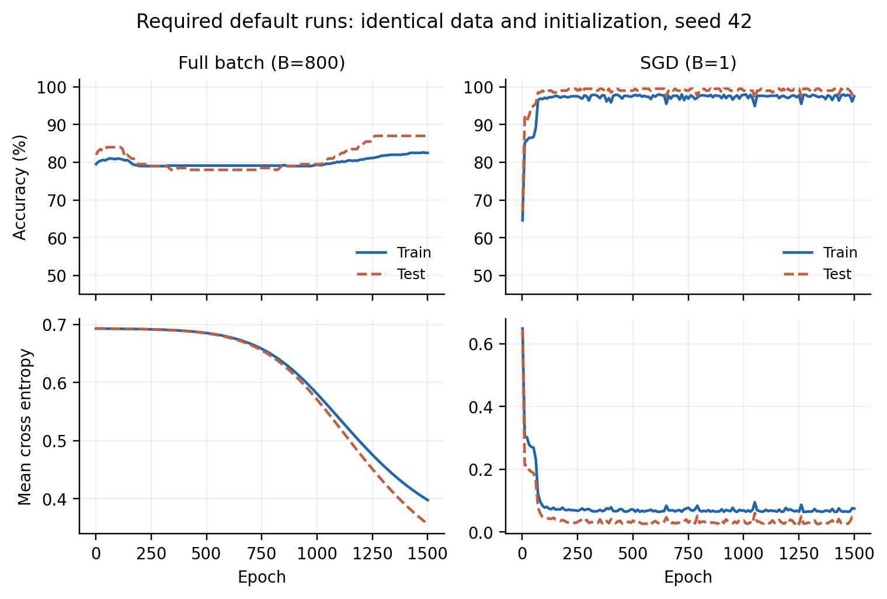

# CS324 Deep Learning — Assignment 1

**Fan Xiaole (Justin Fan) · Student number 12412307**

**Status: submitted to Blackboard, confirmed October 25, 2026.**

The submitted archive is preserved locally as **`12412307_assignment1.zip`**.
Inside it, the written report is `report.pdf`, and the executed notebook is
`report_revision/assignment1_revised.ipynb`.

The GitHub version contains the implementation, executed
[notebook](report_revision/assignment1_revised.ipynb), exact results, report
source, and PNG figures. PDFs, ZIPs, course handouts, earlier versions, caches
and local verification records stay local. In a fresh clone, build the PDF
using the commands below; the report uses PNG figures when vector PDFs are
absent. In the local working folder, the final PDF is
`report_revision/CS324_Assignment1_Revised_Report.pdf`.



## Local folder layout

```text
assigment1/
├── 12412307_assignment1.zip       Final upload archive
├── README.md                     Instructions and navigation
├── Part_1/                       Original perceptron implementation
├── Part_2/                       Original NumPy MLP and training implementation
├── report_revision/              Final report, notebook, experiments and evidence
│   ├── CS324_Assignment1_Revised_Report.pdf
│   ├── CS324_Assignment1_Revised_Report.tex
│   ├── assignment1_revised.ipynb
│   ├── *_experiments.py          Reproduce reported results and figures
│   ├── build_report.py           Generate report source and PDF
│   ├── make_notebook.py          Generate notebook source
│   ├── verify_submission.py      Numerical, result and reproduction checks
│   ├── package_submission.py     Assemble the final ZIP using an explicit file list
│   ├── requirements.txt          Verified Python dependencies
│   ├── results/                  Exact JSON histories, configurations and parameters
│   ├── figures/                  Seven figures as vector PDFs and PNGs
│   └── build/                    Generated LaTeX files; excluded from submission
├── references/                   Supplied assignment and perceptron tutorial PDFs
└── archive/                      Earlier submissions and preserved build/runtime files
```

The submission ZIP contains the report, source modules, executed notebook,
experiment/verification scripts, exact results, figure assets and SHA-256
manifest. The local archive, course handouts, caches and LaTeX build files are
excluded. `references/` and `archive/` are local-only. Every moved pre-existing
file is preserved byte-for-byte; its old
and new locations and checksum are recorded in
`archive/organization_manifest.json`. The original implementation modules
were not changed.

## Environment

Verified with Python 3.11.15, NumPy 1.26.4, scikit-learn 1.3.1 and Matplotlib
3.10.8. Use the existing `mldl` environment, or install the supplied dependencies
in a separate Python 3.11 environment:

```bash
python -m pip install -r report_revision/requirements.txt
```

All commands below run from the assignment root: the folder containing
`Part_1`, `Part_2`, and `report_revision`. No GPU, credentials or dataset
downloads are required.

## Inspect and execute the notebook

The supplied notebook already contains its executed tables and seven embedded
figures. View it in VS Code or another notebook viewer. For a fresh execution:

```bash
python -m nbconvert --to notebook --execute --inplace \
  --ExecutePreprocessor.timeout=120 \
  report_revision/assignment1_revised.ipynb
```

Normal execution reads the exact saved evidence without training. The optional
`RUN_EXPERIMENTS` cell is disabled by default. An interactive `jupyter notebook`
frontend is optional and is not needed for the command above.

## Check the submission

```bash
export OPENBLAS_NUM_THREADS=1 OMP_NUM_THREADS=1
export PYTHONDONTWRITEBYTECODE=1
python report_revision/verify_submission.py
```

The quick check validates all 70 MLP records, budget/sample counts, five-seed
statistics, saved-model endpoints, source fingerprints and numerical gradients.
To additionally retrain the three seed-42 default configurations and compare
their final metrics against the reported values:

```bash
python report_revision/verify_submission.py --reproduce-defaults
```

The fresh default reruns take roughly 25–35 seconds on this machine with one
CPU thread. Timing varies by hardware.

## Reproduce all experiments

```bash
export OPENBLAS_NUM_THREADS=1 OMP_NUM_THREADS=1
export PYTHONDONTWRITEBYTECODE=1
python report_revision/perceptron_experiments.py
python report_revision/mlp_experiments.py
```

Observed compute is about 2.3 seconds for the Gaussian experiments and 140
seconds for the 70-run MLP study. These scripts replace their own generated
results and figures. They preserve the original implementation files.

The perceptron study includes the three required cases and a 36-cell,
five-seed Gaussian study. Trajectory endpoints are checked against independent
calls to the original trainer. The MLP study includes seven batch sizes and
five seeds under both 1,500-epoch and 1,500-update budgets, plus 114 scalar
central finite-difference gradient checks. Actual partial-batch sample counts
are recorded.

To redraw only MLP figures from saved results:

```bash
python report_revision/mlp_experiments.py --plot-only
```

## Rebuild the report and package

```bash
python report_revision/make_notebook.py
python -m nbconvert --to notebook --execute --inplace \
  --ExecutePreprocessor.timeout=120 \
  report_revision/assignment1_revised.ipynb
python report_revision/build_report.py
python report_revision/package_submission.py --output reproduced/12412307_assignment1.zip
```

The report builder requires XeLaTeX and its standard fontspec, TeX Gyre,
tcolorbox, booktabs, caption and hyperref packages. It compiles twice and keeps
auxiliary files in `report_revision/build/`. Reading the supplied PDF or
executing the notebook does not require TeX.

Edit `build_report.py` to change report prose reproducibly. Alternatively, edit
the `.tex` source and compile it from `report_revision`; running the builder
will regenerate that source. Packaging places the generated PDF at `report.pdf`
inside the requested ZIP and verifies every manifest digest. Existing archives
are never overwritten. A fresh clone can also use the default output name;
the local submitted archive remains unchanged when `--output` is used.

## Original baseline commands

```bash
(cd Part_1 && python experiments.py)
(cd Part_2 && python train_mlp_numpy.py --batch_size 0)
(cd Part_2 && python train_mlp_numpy.py --batch_size 1)
```

Defaults: width 20, learning rate 0.01, 1,500 **epochs**, evaluation frequency
10, seed 42. The CLI maps batch size 0 to full batch; the Python training
function uses `None`. `max_steps` counts epochs, not parameter updates.

## Interpretation

- Seed-42 scores reproduce the earlier submission. Five-seed variability is
  reported as sample SD, not confidence intervals.
- Each seed changes the generated data, split, initialization and shuffle order
  together. It does not isolate initialization variability.
- Equal epochs equalize processed examples; equal updates equalize parameter
  updates. Neither is an equal wall-clock comparison.
- Reported scores are final budget endpoints. Test curves and batch sweeps are
  descriptive; no model or checkpoint is selected using the test set.
- The original probability-clipped loss has a documented extreme-logit
  limitation; ordinary-regime gradients and default results pass verification.
